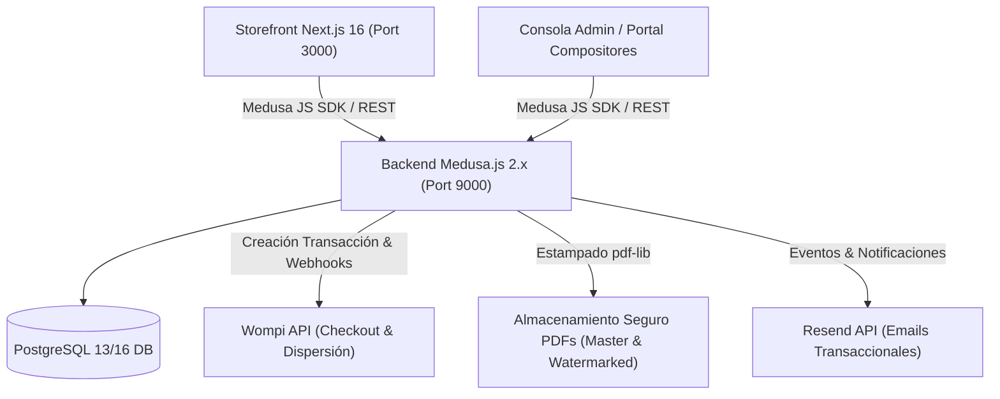

# 🏗️ Plan de Conexión Real: Backend Medusa.js 2.x, Base de Datos & Flujo Transaccional

Este documento detalla la arquitectura, módulos DML, flujos de datos y etapas de desarrollo para transformar el mockup visual de **Piano Colombia** en una plataforma de comercio electrónico digital completamente funcional y transaccional.

---

## 🏛️ 1. Arquitectura del Sistema



---

## 📋 2. Módulos y Modelos de Datos Medusa.js 2.x (DML)

En Medusa.js 2.x, las entidades personalizadas se definen mediante el **Data Modeling Language (DML)** dentro de módulos independientes en `backend/src/modules/`:

### A. Módulo de Compositores (`src/modules/composer/`)
* **`Composer`**:
  * `id`: ID único.
  * `first_name`, `last_name`, `slug`, `artistic_name`.
  * `bio_es`, `bio_en`: Biografía bilingüe.
  * `region`, `era`, `photo_url`.
  * `status`: `PENDING_APPROVAL` | `APPROVED` | `REJECTED` | `SUSPENDED`.
  * `rejection_reason`: Motivo en caso de rechazo.
  * `user_id`: ID de autenticación Medusa Auth.
* **`ComposerBankAccount`**:
  * `account_type`: `AHORROS` | `CORRIENTE` | `NEQUI` | `DAVIPLATA`.
  * `bank_code`, `bank_name`.
  * `account_number`, `holder_name`, `document_type`, `document_number`.

### B. Módulo de Partituras & Licencias (`src/modules/score/`)
* **`Score`** (Vinculado a `Product` de Medusa):
  * `id`, `composer_id`.
  * `difficulty`: `PRINCIPIANTE` | `INTERMEDIO` | `AVANZADO`.
  * `genre`: `BAMBUCO` | `PASILLO` | `DANZA` | `CLASICO` | `OTRO`.
  * `pages_count`, `duration_approx`, `year_composition`.
  * `status`: `DRAFT` | `IN_REVIEW` | `APPROVED` | `REJECTED`.
  * `original_pdf_url`: Ubicación del archivo maestro seguro.
  * `preview_pdf_url`: Muestra con opacidad al 40% y marca diagonal.
* **`CustomerDownload`**:
  * `id`, `order_id`, `customer_id`, `score_id`.
  * `download_token`: Token temporal criptográfico.
  * `download_count`, `max_downloads` (por defecto 5).
  * `watermarked_pdf_url`: Archivo firmado con metadatos del comprador.
  * `expires_at`: Fecha de expiración del enlace.

### C. Módulo de Liquidaciones & Regalías (`src/modules/payout/`)
* **`PayoutBatch`**:
  * `id`, `period_start`, `period_end`, `status` (`DRAFT` | `PROCESSING` | `COMPLETED` | `FAILED`).
  * `total_gross`, `total_commission_pc` (20%), `total_net_composers` (80%).
  * `wompi_batch_id`, `executed_at`, `executed_by_admin_id`.
* **`PayoutItem`**:
  * `id`, `payout_batch_id`, `composer_id`, `amount_gross`, `commission_pc`, `amount_net`.
  * `wompi_transfer_id`, `status` (`PENDING` | `TRANSFERRED` | `REJECTED`).

### D. Módulo de CMS & Contenidos (`src/modules/cms/`)
* **`HeroBanner`**:
  * `id`, `title`, `description`, `button1_text`, `button1_link`, `button2_text`, `button2_link`, `urtext_badge_text`, `featured_score_id`.

---

## 💳 3. Proveedor de Pagos Wompi & Webhooks

1. **Custom Payment Provider (`src/modules/payment-wompi`)**:
   * Generación de firma de integridad SHA-256 (`reference + amount_in_cents + currency + integrity_secret`).
   * Manejo de transacciones en COP y conversión automática para tarjetas internacionales en USD.
2. **Endpoint de Webhooks (`POST /api/webhooks/wompi`)**:
   * Validación del checksum del webhook enviado por Wompi.
   * Transición del pedido a `paid` al recibir `event: "transaction.updated"` con `status: "APPROVED"`.
   * Disparo automático del flujo de **Estampado de PDF** y envío de correo vía Resend.

---

## 🛡️ 4. Motor de Estampado de Partituras (`pdf-lib`)

Al confirmarse el pago de un pedido:
1. El backend descarga temporalmente el PDF maestro original.
2. Un worker en Node.js usando `pdf-lib` estampa en el margen inferior de cada página:
   ```text
   Licencia Oficial Piano Colombia · Comprador: [Nombre Cliente] · ID: [Cédula/NIT] · Ref Wompi: [Ref] · [Fecha]
   ```
3. Guarda el archivo firmado de forma segura y genera un enlace protegido con token único en `/mi-cuenta/descargas`.

---

## 🔄 5. Fases de Ejecución Propuestas

### 📍 Fase 1: Configuración de Base de Datos & Backend Medusa 2.x
* Crear base de datos `piano_colombia_db` en el PostgreSQL local.
* Configurar variables de entorno `.env` en `backend/` (puerto 9000, CORS, Secrets).
* Implementar los módulos DML (`Composer`, `Score`, `CustomerDownload`, `Payout`, `CMS`).
* Ejecutar migraciones iniciales (`npx medusa db:migrate`).

### 📍 Fase 2: Autenticación, Roles & Endpoints REST
* Configurar autenticación para Compradores, Compositores y Administradores (RBAC).
* Implementar rutas API para:
  * Registro y aprobación de compositores (`/admin/compositores`).
  * Subida de partituras y calculadora de comisiones (`/compositor/partituras`).
  * Gestión de CMS (`/admin/cms`).

### 📍 Fase 3: Conexión del Storefront Next.js (`storefront/`)
* Configurar cliente SDK de Medusa en Next.js.
* Reemplazar mock data del catálogo `/tienda`, `/compositores` y `/partitura/[slug]` con queries reales del backend.
* Conectar `CartContext` con el carrito oficial de Medusa.

### 📍 Fase 4: Integración Wompi Checkout & Webhook Listener
* Conectar el formulario de `/checkout` con la generación de referencias de Wompi.
* Implementar el webhook de confirmación y prueba con transacciones en modo Sandbox de Wompi.

### 📍 Fase 5: Estampado PDF, Descargas & Notificaciones Resend
* Implementar el worker `pdf-lib` y el flujo de descarga en `/mi-cuenta/descargas`.
* Conectar el envío de correos con la API de Resend.

### 📍 Fase 6: Dispersión Masiva de Pagos Wompi
* Conectar la consola `/admin/pagos` con la API de transferencias masivas de Wompi para liquidar a los compositores.

---

## 🧪 Plan de Verificación

1. **Migraciones & Base de Datos**: Verificar que las tablas y relaciones se creen correctamente en PostgreSQL.
2. **Pruebas de API**: Probar los endpoints de creación, listado y aprobación mediante requests HTTP.
3. **Prueba End-to-End en Storefront**:
   * Registrar un compositor demo y aprobarlo desde `/admin/compositores`.
   * Subir una partitura y publicarla tras moderación.
   * Realizar una compra de prueba en `/checkout` con Wompi Sandbox.
   * Verificar la generación del PDF con la marca de agua personalizada en `/mi-cuenta/descargas`.
